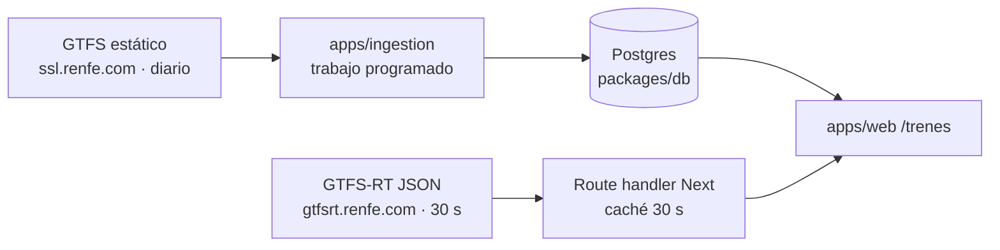

# Trenes: propuesta para la experiencia pública de Renfe

Propuesta de investigación para [#15](https://github.com/samuelcorsan/reforma-digital/issues/15). Este documento es el brief: contexto, inventario de flujos, alcance y arquitectura. El [mapa de pantallas](pantallas.md) y los [criterios de éxito](criterios.md) lo completan. Las fuentes se consultaron el 19/10/2026.

Es una iniciativa aparte del chat de trámites y de la extensión. No está vinculada a Renfe ni a Adif.

## Resumen

- Renfe estrena un sistema de venta nuevo el **28/10/2026**: desde ese día se compran en él los viajes con salida a partir del 25/01/2027, los anteriores siguen en el sistema actual y el 25/01/2027 toda la venta pasa al nuevo ([nota de prensa](https://grupo.renfe.com/es/es/sala-de-prensa/noticias/2026/09/renfe-transforma-sistema-de-venta)). Rediseñar ahora la compra es trabajo que caduca en semanas.
- Lo que ese anuncio no cubre es lo que más se consulta cuando algo falla: si mi tren va bien, qué incidencias hay en mi línea, qué me corresponde si llega tarde y cómo pido asistencia. Renfe publica datos abiertos oficiales con licencia CC BY 4.0 para resolverlo sin cuentas, pagos ni datos personales.
- Proponemos dos fases. **Fase 1:** una sección pública de información en `apps/web` (horarios, estado en tiempo real, incidencias, derechos y accesibilidad) que enlaza a renfe.com para comprar y reclamar. **Fase 2:** después del 25/01/2027, auditar la compra nueva con los mismos criterios y decidir entonces si hace falta algo más.

## Contexto que condiciona la propuesta

- **Sistema de venta nuevo.** Durante la transición hay una sola puerta de entrada que lleva a un sistema u otro según la fecha del viaje. Renfe promete comparar trenes por precio, duración, servicios y ocupación, mostrar las condiciones antes de confirmar y gestionar cambios, facturas e indemnizaciones desde el propio billete. Todo eso está anunciado, no verificado.
- **Incidente de ciberseguridad.** Renfe informa de un acceso no autorizado del 24/09/2026 a sistemas de venta, con posible exposición de datos identificativos, DNI/NIE, viajes y contraseñas cifradas, y avisa del riesgo de suplantación ([comunicado](https://www.renfe.com/es/es/ayuda/notificacion-personas-afectadas)). Cualquier interfaz que se parezca a Renfe o pida un localizador refuerza ese riesgo. Por eso esta propuesta no usa su marca ni pide datos.
- **Accesibilidad declarada.** renfe.com se declara «parcialmente conforme» con el [RD 1112/2018](https://www.boe.es/buscar/act.php?id=BOE-A-2018-12699) y enumera 22 incumplimientos de la UNE-EN 301549, entre ellos el zoom, el foco, las etiquetas y los mensajes de estado. La declaración se revisó por última vez el 29/09/2024 ([declaración](https://www.renfe.com/es/es/ayuda/informacion-legal-viajeros/accesibilidad-web)). Además, la [Ley 11/2023](https://www.boe.es/buscar/act.php?id=BOE-A-2023-11022) (art. 2.2.c) exige accesibilidad a webs, apps, billetes electrónicos e información en tiempo real del transporte ferroviario desde el 28/06/2025. Para los servicios urbanos, suburbanos y regionales solo exige los terminales interactivos, y hay un régimen transitorio hasta 2030.
- **Rodalies.** La nueva empresa mixta Renfe–Generalitat y el posible cambio de marca pueden mover enlaces y canales en Catalunya. Lo revisaremos antes de enlazar.

## Inventario de flujos críticos

Observado el 19/10/2026 en móvil (390 px). El método y las cifras completas están en [criterios.md](criterios.md#línea-base).

| Flujo                    | Dónde vive hoy                                                                                                                              | Qué observamos                                                                                                                                                                                                                                                                      | ¿Lo cambia el sistema nuevo? | Oportunidad                                                                              |
| ------------------------ | ------------------------------------------------------------------------------------------------------------------------------------------- | ----------------------------------------------------------------------------------------------------------------------------------------------------------------------------------------------------------------------------------------------------------------------------------- | ---------------------------- | ---------------------------------------------------------------------------------------- |
| Buscar horario o billete | Buscador en `www.renfe.com` → resultados en `venta.renfe.com/vol/*.do`. Horarios de Cercanías en un iframe de `horarioscercanias.renfe.com` | Viene preseleccionada ida y vuelta (hoy y mañana). Los resultados cargan reCAPTCHA, y un aviso sobre indemnizaciones ocupa casi toda la primera pantalla. A los 6 s seguía en «Estamos buscando tu viaje». Entrar directamente en `buscarTren.do` muestra «1 ERROR» sin explicación | Sí                           | Horarios y estado desde GTFS sin pasar por la venta                                      |
| Comprar                  | `venta.renfe.com`: reCAPTCHA, datos de viajeros, pago                                                                                       | No se recorrió: se detiene antes del CAPTCHA y de los datos personales                                                                                                                                                                                                              | Sí                           | Ninguna en fase 1. Auditar en fase 2                                                     |
| Billete y posventa       | Menú «Gestiona tu billete», con cambiar, anular, factura, indemnización y reclamación                                                       | Las condiciones están repartidas en varias páginas de ayuda y dependen de la tarifa (Básico, Elige, Prémium, Avant/MD, Cercanías)                                                                                                                                                   | Sí (anunciado)               | Explicar condiciones y plazos antes de entrar y enlazar el trámite oficial               |
| Incidencias y estado     | Avisos en la sala de prensa, WhatsApp (solo 2 líneas), apps separadas de Renfe, Cercanías y Adif, y datos abiertos                          | El feed abierto de avisos (`alerts.json`) solo cubre Cercanías y lleva sin actualizarse desde el 07/10/2026. Contiene avisos de obras ya terminadas («del 10 al 12 de octubre») sin fecha de fin. Los feeds de horarios y posiciones sí están al día                                | No consta                    | Una vista por tren y por línea que muestre la antigüedad del dato                        |
| Asistencia (PMR)         | Adif Acerca (antes Atendo), gestionado por Adif. Renfe lo explica en su web                                                                 | 70 estaciones con servicio permanente (solicitud hasta 30 min antes) y 76 con servicio puntual (12 h). El teléfono de Renfe aparece como 91 320 320, 912 320 320 o 902 320 320 según la fuente                                                                                      | No                           | Estación y tren accesibles (los GTFS lo incluyen) junto a cómo y cuándo pedir asistencia |
| Derechos por retraso     | Página «Compromiso de puntualidad» y formularios de `venta.renfe.com`                                                                       | Hay tres capas de normas con conflictos (ver abajo)                                                                                                                                                                                                                                 | No consta                    | Explicar cada capa con su fuente sin decidir por la persona                              |

### Indemnizaciones: tres capas que no coinciden

| Capa        | Qué dice                                                                                                                                                                                                                                                               | Fuente                                                                                                                                                                    |
| ----------- | ---------------------------------------------------------------------------------------------------------------------------------------------------------------------------------------------------------------------------------------------------------------------- | ------------------------------------------------------------------------------------------------------------------------------------------------------------------------- |
| UE (mínimo) | 25 % con retrasos de 60 a 119 min y 50 % desde 120 min. Las acciones del administrador de infraestructuras **no** eximen de indemnizar (art. 19.10). Formulario común voluntario                                                                                       | [Reglamento (UE) 2021/782](https://www.boe.es/doue/2021/172/L00001-00052.pdf), [Reglamento de Ejecución (UE) 2024/949](https://boe.gob.es/doue/2024/949/L00001-00007.pdf) |
| Renfe (hoy) | AVE y Larga Distancia: 50 % desde 60 min y 100 % desde 90 min. Media Distancia y Avant con tramos desde 15 min. Excluye los retrasos por limitaciones temporales de velocidad de Adif en billetes comprados desde el 31/01/2026. Plazo de 24 h a 3 meses tras el viaje | [Compromiso de puntualidad](https://www.renfe.com/es/es/ayuda/compromiso-puntualidad)                                                                                     |
| Ley 9/2025  | La DA 31.ª ordena recuperar, con efectos desde el 01/01/2026, el 50 % a los 15 min y el 100 % a los 30 min en Alta Velocidad y Larga Distancia. Renfe sostiene que está pendiente de desarrollo reglamentario                                                          | [BOE-A-2025-24545](https://www.boe.es/buscar/act.php?id=BOE-A-2025-24545)                                                                                                 |

La interfaz no resuelve el conflicto: muestra las tres capas, de dónde sale cada una y dónde reclamar.

## Alcance

**Fase 1, información pública (ahora):**

- Horarios por origen, destino y fecha; ficha de cada tren con su estado en tiempo real; avisos por línea de Cercanías.
- Accesibilidad de estaciones y trenes (`wheelchair_boarding` y `wheelchair_accessible` de los GTFS) y cómo pedir Adif Acerca.
- Derechos ante retrasos y condiciones de cambio y anulación por tarifa, con fuentes y fecha.
- Cada acción (comprar, reclamar, pedir asistencia) termina en un enlace a la web oficial con el dominio visible.

**Fase 2, compra (desde el 25/01/2027):** repetir la línea base de [criterios.md](criterios.md) sobre el flujo nuevo y publicar los resultados. Solo si persisten problemas en pantallas públicas previas a la compra se valorará adaptarlas con la extensión, siguiendo CONTRIBUTING.md.

**Fuera de alcance:**

- Vender billetes o intermediar en la compra.
- Pedir o guardar localizador, DNI, cuenta o tarjeta.
- Sustituir el reCAPTCHA, el pago o el login.
- Consumir APIs internas (`wsrestcorp.renfe.es`, `venta.renfe.com`) o datos de Adif sin una licencia pública.
- Usar el logotipo, los colores o el nombre de Renfe como identidad propia.

## Arquitectura de la fase 1

- **Mismo patrón que El Congreso.** Un trabajo programado normaliza los GTFS y los publica en Postgres. La web solo lee. No hace falta ningún servicio nuevo.
- **Tiempo real en el servidor.** `gtfsrt.renfe.com` no envía cabeceras CORS, así que el navegador no puede leerlo directamente. Usamos la variante JSON de los feeds, lo que evita añadir una dependencia de Protocol Buffers.
- **Antigüedad del dato.** Cada respuesta conserva `header.timestamp`. Por encima de un umbral, la interfaz dice «sin actualizar desde…» en lugar de presentar el dato como actual.
- **GTFS no estándar.** Las cabeceras de los CSV llevan espacios de relleno y no hay `feed_info.txt`. La ingesta normaliza las columnas y registra la fecha de descarga como versión.
- **Diseño.** Sol y shadcn según [DESIGN.md](../../DESIGN.md), con componentes de servidor y JavaScript de cliente solo para el buscador de estaciones.
- **Licencia.** La atribución CC BY 4.0 a Renfe Data aparece en cada vista que use sus datos.

## Fuentes

Datos abiertos ([data.renfe.com](https://data.renfe.com/dataset), CC BY 4.0, 44 conjuntos):

- GTFS de [Cercanías](https://data.renfe.com/dataset/horarios-cercanias): 767 rutas, 1.147 paradas, vigente del 19/10 al 17/11/2026.
- GTFS de [AV/LD/MD](https://data.renfe.com/dataset/horarios-de-alta-velocidad-larga-distancia-y-media-distancia): 658 rutas, 1.006 paradas, excepciones de calendario hasta el 24/01/2027.
- GTFS-RT: [horarios de Cercanías](https://data.renfe.com/dataset/horarios-viaje-cercanias), [horarios de AV/LD/MD](https://data.renfe.com/dataset/horarios-viaje-alta-velocidad-larga-media-distancia), [posiciones](https://data.renfe.com/dataset/ubicacion-vehiculos) y [avisos](https://data.renfe.com/dataset/incidencias-avisos).

Normativa:

- [Reglamento (UE) 2021/782](https://www.boe.es/doue/2021/172/L00001-00052.pdf), arts. 9, 10, 18, 19, 24 y 28.
- [Reglamento de Ejecución (UE) 2024/949](https://boe.gob.es/doue/2024/949/L00001-00007.pdf).
- [Ley 9/2025](https://www.boe.es/buscar/act.php?id=BOE-A-2025-24545), DA 31.ª.
- [Ley 11/2023](https://www.boe.es/buscar/act.php?id=BOE-A-2023-11022), art. 2.2.c y disposición transitoria única.
- [RD 1112/2018](https://www.boe.es/buscar/act.php?id=BOE-A-2018-12699).

Páginas oficiales:

- [Cambiar billete](https://www.renfe.com/es/es/ayuda/cambiar-billete), [anular billete](https://www.renfe.com/es/es/ayuda/anular-billete), [compromiso de puntualidad](https://www.renfe.com/es/es/ayuda/compromiso-puntualidad) y [reclamaciones](https://www.renfe.com/es/es/ayuda/informacion-legal-viajeros/reclamaciones).
- [Servicio de asistencia](https://www.renfe.com/es/es/viajar/informacion-util/servicio-de-asistencia/que-es) y [estaciones de Adif Acerca](https://www.adif.es/viajeros/accesibilidad-estaciones). Este último enlace sale de la página de Renfe, pero adif.es responde 403 al acceso automatizado y no pudimos comprobarlo.
- [Avisos por WhatsApp](https://www.renfe.com/es/es/ayuda/suscripcion-avisos-whatsapp).

Del [sitemap](https://www.renfe.com/sitemap.xml), 1.296 de las 1.871 URLs en castellano (69 %) son de inspiración o revista. 68 son de ayuda y gestión del billete, y 44 de ellas, de información legal.

## Decisiones abiertas

- Nombre y ruta de la sección. Proponemos `/trenes`, sin la marca Renfe.
- De dónde sacar la modalidad de Adif Acerca de cada estación: la lista de adif.es no se puede leer de forma automatizada. Hay que pedírsela a Adif o mantenerla a mano con su fecha.
- Otros operadores (Ouigo, Iryo): no hemos investigado sus datos, así que quedan fuera de la v1.
- Umbral de antigüedad por feed. Proponemos 2 min para horarios y posiciones y 15 min para avisos, pero hay que calibrarlo con datos reales.
- Si el proyecto comunica estos hallazgos a Renfe por su canal de accesibilidad.
