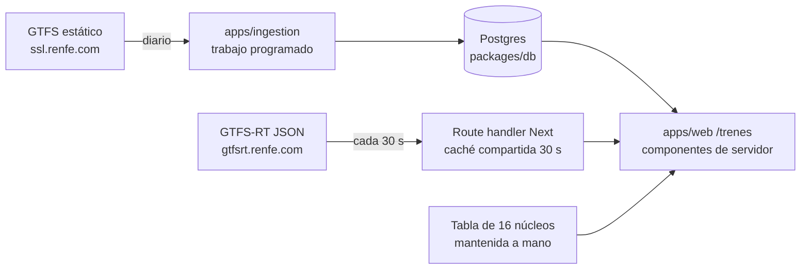

# Trenes: arquitectura, diseño, accesibilidad y rendimiento

Cómo se construiría la fase 1 del [brief](README.md): arquitectura de la información, arquitectura técnica, sistema de diseño, accesibilidad, rendimiento y uso de IA. Las cifras salen de los datos descargados el 19/10/2026.

## Arquitectura de la información

renfe.com se organiza según cómo está estructurada la empresa: Cercanías, Viaja, Inspírate, Gestiona tu billete y Más Renfe. 1.296 de las 1.871 URLs en castellano del sitemap son de inspiración o revista. Proponemos organizarla según lo que la persona necesita en cada momento:

| Momento         | Pregunta                                        | Pantalla                              |
| --------------- | ----------------------------------------------- | ------------------------------------- |
| Antes de viajar | ¿Qué trenes hay y cuánto tardan?                | Horarios                              |
| Antes de viajar | ¿Puedo ir en silla de ruedas? ¿Cómo pido ayuda? | Estación, Asistencia                  |
| Hoy             | ¿Va bien mi tren o mi línea?                    | Tren, Línea de Cercanías              |
| Después         | Ha llegado tarde o quiero cambiarlo, ¿qué hago? | Mi tren llegó tarde, Cambiar o anular |

El modelo es **viaje → tren → estación**. Todas las pantallas cuelgan de un origen, un destino y una fecha, de un tren concreto o de una estación. El tipo de servicio (AVE, Avlo, Alvia, Media Distancia, Avant, Cercanías) es un atributo del tren, no una sección del menú.

### Lenguaje

Cada término de Renfe se muestra junto a una explicación. No se sustituye, porque es el que la persona encontrará en su billete y en renfe.com.

| Término oficial                                               | Cómo lo explicamos                                                                                                                                                      |
| ------------------------------------------------------------- | ----------------------------------------------------------------------------------------------------------------------------------------------------------------------- |
| Básico, Elige, Prémium                                        | Cuánto cuesta cambiar o anular cada uno (ver [cambiar](https://www.renfe.com/es/es/ayuda/cambiar-billete) y [anular](https://www.renfe.com/es/es/ayuda/anular-billete)) |
| Localizador, código de compra, número de billete (13 dígitos) | Tres identificadores distintos. Decimos cuál pide cada trámite                                                                                                          |
| Formalizar o desformalizar un abono                           | Reservar o liberar la plaza de un viaje con tu abono                                                                                                                    |
| Limitación temporal de velocidad (LTV)                        | Tramo donde Adif obliga a ir más despacio. Desde el 31/01/2026, Renfe no indemniza los retrasos que causan                                                              |
| Núcleo de Cercanías                                           | Red de Cercanías de tu zona                                                                                                                                             |
| Máquina autoventa                                             | Máquina de billetes de la estación                                                                                                                                      |
| Combinado Cercanías                                           | Viaje en Cercanías incluido con tu billete de AVE o Larga Distancia, de 4 h antes a 4 h después                                                                         |
| Adif Acerca (antes Atendo)                                    | Asistencia gratuita en la estación para personas con discapacidad o movilidad reducida                                                                                  |

## Arquitectura técnica

**Volumen real.** Cercanías: 1.866.938 filas en `stop_times` (282 MB sin comprimir), 135.815 viajes y 1.147 paradas. AV/LD/MD: 65.470 filas, 8.387 viajes y 1.006 paradas. Con este volumen descartamos ficheros estáticos en el build y usamos Postgres con índices por parada y hora.

**Ingesta diaria.** Funciona como la de El Congreso: un workflow programado descarga los ZIP (16 MB + 0,9 MB) y no hace nada si el hash no ha cambiado. Normaliza las cabeceras, que llegan con espacios de relleno, y publica las tablas en una sola transacción para que la web nunca lea una mezcla de dos versiones. Como no hay `feed_info.txt`, guarda la fecha de descarga y el hash como versión. Se hace con Python, cuyo módulo `csv` de la biblioteca estándar basta, sin dependencias nuevas.

**Tiempo real.** Un route handler lee los cinco feeds JSON con caché compartida de 30 s, que es el `max-age` que ya declara Renfe. Así, una sola petición a Renfe sirve a todas las personas. Hay que hacerlo en el servidor porque `gtfsrt.renfe.com` no envía cabeceras CORS. Al usar JSON no hace falta añadir una dependencia de Protocol Buffers.

**Cruce de datos, comprobado el 19/10/2026:**

| Cruce                                                      | Coinciden                          |
| ---------------------------------------------------------- | ---------------------------------- |
| `tripId` de horarios en tiempo real con `trip_id` del GTFS | 170/170 (LD) y 221/221 (Cercanías) |
| `stopId` de horarios en tiempo real con `stop_id`          | 116/116 y 245/245                  |
| Posiciones con viaje del GTFS                              | 104/104 y 216/217                  |
| `routeId` de los avisos con `route_id`                     | 1.171/1.316 (89 %)                 |

Los avisos cuya línea no existe en el GTFS se muestran en la red de Cercanías que indica el prefijo de su `routeId` (10 Madrid, 51 Rodalies…). El GTFS no trae el nombre de cada red, así que la tabla de 16 redes se mantiene a mano con su fuente.

**Cuando algo falla:**

| Fallo                               | Qué hace la web                                                                                                                                                      |
| ----------------------------------- | -------------------------------------------------------------------------------------------------------------------------------------------------------------------- |
| El tiempo real no responde          | Muestra el horario programado con «sin datos en tiempo real»                                                                                                         |
| `header.timestamp` supera el umbral | Muestra «sin actualizar desde…» y nunca «sin incidencias»                                                                                                            |
| Aviso sin `activePeriod.end`        | Muestra la fecha de inicio y «Renfe no indica cuándo termina». Las fechas relativas del texto («hoy») se presentan junto a la fecha del aviso                        |
| La ingesta diaria falla             | Se sigue sirviendo la última versión publicada e indica su fecha. Si ya ha pasado el último día de `calendar`, la web lo dice en lugar de devolver resultados vacíos |

## Sistema de diseño

Se usa Sol y shadcn de [DESIGN.md](../../DESIGN.md), sin colores ni tipografías de Renfe. Lo que ya existe y lo que haría falta:

| Necesidad                  | Se reutiliza                                                            | Es nuevo                                                                                                               |
| -------------------------- | ----------------------------------------------------------------------- | ---------------------------------------------------------------------------------------------------------------------- |
| Buscar estación            | `Combobox` de `packages/design/ui`, como `ProvincePicker` en Elecciones | —                                                                                                                      |
| Enlazar una fuente oficial | `Source` de `components/congreso/common.tsx`                            | Mover el componente a un sitio compartido si lo usan dos secciones                                                     |
| Avisos y conflictos        | `Callout` de `packages/design/src/ui`                                   | —                                                                                                                      |
| Lista vacía                | `Empty` de Congreso                                                     | —                                                                                                                      |
| Texto generado con IA      | `AI` de Congreso, con su etiqueta                                       | —                                                                                                                      |
| Estado de un tren          | `Badge`                                                                 | `TrainStatus`: puntual, retraso de N min, cancelado o sin datos. El estado se dice siempre en texto, no solo con color |
| Antigüedad del dato        | —                                                                       | `DataAge`: «hace 40 s» o «sin actualizar desde…», con `<time datetime>`                                                |
| Paradas de un tren         | `Table` en escritorio                                                   | `StopList`: lista ordenada con hora prevista y hora estimada                                                           |

Los tres componentes nuevos empiezan dentro de `apps/web/components/trenes`. Solo pasarán a `packages/design` si otra sección los necesita.

## Accesibilidad

El objetivo es WCAG 2.2 AA (ver [criterios](criterios.md#accesibilidad)). Patrones concretos:

- **Zoom libre.** Se usa el viewport de Next sin `maximum-scale` ni `user-scalable`.
- **Buscador de estaciones.** `Combobox` con nombre accesible y la lista de sugerencias anunciada. Debe aceptar escritura sin tildes («Atocha», «Leon») y nombres cooficiales («Girona», «Lleida»).
- **Horas.** `<time>` con `datetime`. El retraso se escribe como frase («llega 23 min tarde, a las 11:53») y no solo como «+23» o un color.
- **Cambios en vivo.** Una sola región `aria-live="polite"` por pantalla, que solo anuncia cuando cambia el estado del tren y no en cada actualización de 30 s.
- **Tablas.** La lista de paradas usa `<ol>` y no una tabla visual, para que sea legible a 390 px y con lector de pantalla.
- **Movimiento.** Sin mapas animados ni carruseles. La posición del tren se da en texto («entre Zaragoza y Lleida»). Un mapa, si se añade, es opcional y tiene alternativa textual.
- **Idioma.** `lang` correcto en cada parte. Los avisos de Renfe se muestran en el idioma original y con su `lang`.

## Rendimiento

- **Componentes de servidor por defecto.** Solo el buscador de estaciones y la actualización del tiempo real llevan JavaScript de cliente.
- **Páginas cacheables.** La ficha de estación y los horarios programados se cachean por día de servicio. Lo que es en tiempo real se pide aparte y se refresca cada 30 s solo mientras la pestaña está visible (`visibilitychange`).
- **Sin terceros.** Fuentes servidas por Next, sin mapas externos, sin scripts de Renfe y sin iframes.
- **Presupuesto.** 150 KiB de JavaScript comprimido o menos y 500 KiB por ruta, frente a 1,3–4,3 MiB de JavaScript en las páginas de renfe.com medidas ([línea base](criterios.md#línea-base)).

## IA

La sección funciona sin IA. Solo proponemos usarla donde ayuda y se puede verificar, con el mismo criterio que El Congreso (modelos de NaN y la etiqueta «generado con IA»):

| Uso                                                            | Decisión                                                                                                                                                                |
| -------------------------------------------------------------- | ----------------------------------------------------------------------------------------------------------------------------------------------------------------------- |
| Calcular qué indemnización corresponde                         | **No.** Son reglas deterministas con fuente y una IA no debe interpretarlas                                                                                             |
| Horarios, retrasos y accesibilidad                             | **No.** Son datos estructurados que se muestran tal cual                                                                                                                |
| Resumir en lenguaje claro un aviso largo de Renfe              | **Opcional.** Se marca con `AI` y el texto original queda siempre visible al lado. Si el resumen añade una fecha o una estación que no está en el original, se descarta |
| Extraer la fecha de fin que solo aparece en el texto del aviso | **No en la v1.** Un error haría pasar por terminada una incidencia que sigue abierta                                                                                    |
| Preguntas libres sobre trenes                                  | **Fuera de la v1.** El pipeline de `packages/ai` podría responderlas limitado a los dominios oficiales, pero hay que evaluarlo primero                                  |
