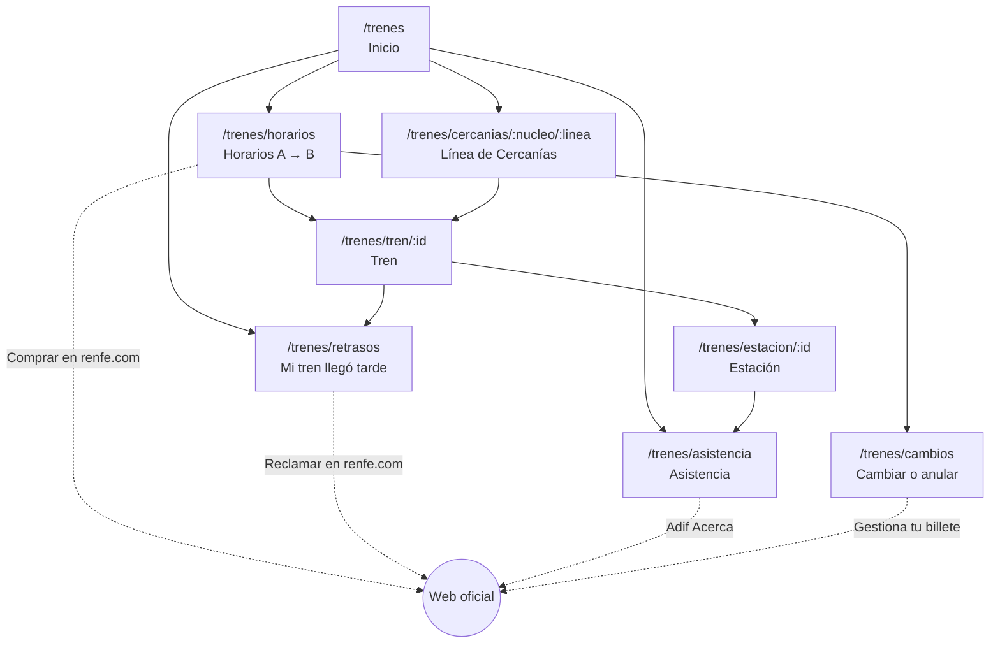

# Trenes: mapa de pantallas

Pantallas de la fase 1 del [brief](README.md). Se diseñan primero a 390 px y cada una responde una sola pregunta. Para comprar, reclamar o pedir asistencia, la persona sale a la web oficial.

## Mapa



## Pantallas

| Pantalla                                                  | Pregunta                             | Datos y fuente                                                                                                                                                                                                 | Acción principal                                                                     |
| --------------------------------------------------------- | ------------------------------------ | -------------------------------------------------------------------------------------------------------------------------------------------------------------------------------------------------------------- | ------------------------------------------------------------------------------------ |
| **Inicio** `/trenes`                                      | ¿Qué necesito?                       | Ninguno, solo navegación                                                                                                                                                                                       | Buscar origen y destino                                                              |
| **Horarios** `/trenes/horarios?de=&a=&fecha=`             | ¿Qué trenes hay y cómo van?          | GTFS AV/LD/MD y Cercanías (horario, tipo, duración, `wheelchair_accessible`) y GTFS-RT (retraso)                                                                                                               | Abrir un tren. Enlace secundario: «Comprar en renfe.com»                             |
| **Tren** `/trenes/tren/:id`                               | ¿Dónde está y a qué hora llega?      | `stop_times`, `trip_updates` (retraso por parada), `vehicle_positions` y avisos que afectan a su línea                                                                                                         | Ver paradas. Si el retraso supera un umbral de indemnización, «¿Qué me corresponde?» |
| **Línea de Cercanías** `/trenes/cercanias/:nucleo/:linea` | ¿Hay incidencias en mi línea?        | `alerts` filtrados por `routeId`, con próximos trenes y su retraso                                                                                                                                             | Ver próximos trenes                                                                  |
| **Estación** `/trenes/estacion/:id`                       | ¿Es accesible y cómo pido ayuda?     | GTFS `stops` (`wheelchair_boarding`) y la modalidad de Adif Acerca (permanente o puntual) según la [lista de Adif](https://www.adif.es/viajeros/accesibilidad-estaciones), pendiente de una fuente verificable | Pedir asistencia                                                                     |
| **Mi tren llegó tarde** `/trenes/retrasos`                | ¿Qué me corresponde y dónde lo pido? | Tres capas de normas (ver [brief](README.md#indemnizaciones-tres-capas-que-no-coinciden)) y plazos                                                                                                             | «Reclamar en renfe.com»                                                              |
| **Cambiar o anular** `/trenes/cambios`                    | ¿Qué permite mi billete?             | [Cambiar](https://www.renfe.com/es/es/ayuda/cambiar-billete) y [anular](https://www.renfe.com/es/es/ayuda/anular-billete) por tarifa y tipo de tren                                                            | «Gestiona tu billete» en renfe.com                                                   |
| **Asistencia** `/trenes/asistencia`                       | ¿Cómo y cuándo la pido?              | [Servicio de asistencia](https://www.renfe.com/es/es/viajar/informacion-util/servicio-de-asistencia/que-es): canales y plazos (30 min o 12 h según la estación)                                                | Llamar o escribir a Adif Acerca                                                      |

**Mi tren llegó tarde** no pide localizador, importe ni datos personales. Solo hace tres preguntas: tipo de tren, fecha de compra y minutos de retraso. Las respuestas no se guardan y no salen del navegador.

## Dos pantallas a 390 px

Boceto con datos ficticios.

```
Tren · AVE 03063                      Mi tren llegó tarde
Madrid-Puerta de Atocha → Barcelona   ─────────────────────────────
─────────────────────────────         Tipo de tren   [AVE/LD    ▾]
● Retraso de 23 min                   Comprado el    [12/02/2026  ]
  Dato oficial de hace 40 s           Retraso        [75] min
─────────────────────────────         ─────────────────────────────
08:00  Madrid-Puerta de Atocha  ✓     Renfe: 50 %
09:21  Zaragoza-Delicias  09:44 ●       Compromiso de puntualidad ↗
11:30  Barcelona-Sants   ~11:53       UE: 25 % (mínimo)
─────────────────────────────           Reglamento 2021/782, art. 19 ↗
Aviso de la línea                     ⚠ Si la causa es una limitación
  Sin avisos abiertos                   de velocidad de Adif, Renfe no
─────────────────────────────           indemniza; la UE no lo exime.
[ ¿Qué me corresponde? ]                Ley 9/2025, DA 31.ª ↗
                                      ─────────────────────────────
Datos: Renfe Data · CC BY 4.0         Plazo: de 24 h a 3 meses tras
                                      el viaje
                                      [ Reclamar en renfe.com ↗ ]
```

## Estados comunes a todas las pantallas

| Estado                 | Qué muestra                                                                                                                                                                          |
| ---------------------- | ------------------------------------------------------------------------------------------------------------------------------------------------------------------------------------ |
| Identidad              | «Proyecto independiente, sin vinculación con Renfe ni Adif», sin logotipo ni colores de Renfe                                                                                        |
| Dato desactualizado    | «Sin actualizar desde las 09:32 del 07/10», calculado con `header.timestamp`, nunca como estado actual. Con el feed de avisos tal como estaba el 19/10/2026, esto es lo que se vería |
| Aviso sin fecha de fin | Su fecha de inicio y «Renfe no indica cuándo termina»                                                                                                                                |
| Fuentes en conflicto   | Cada fuente con su enlace. No elegimos una por la persona                                                                                                                            |
| Sin datos              | Qué falta y el enlace a la página oficial equivalente                                                                                                                                |
| Enlace externo         | Dominio visible y solo hacia dominios oficiales (`renfe.com`, `adif.es`, `boe.es`, `data.renfe.com`)                                                                                 |
