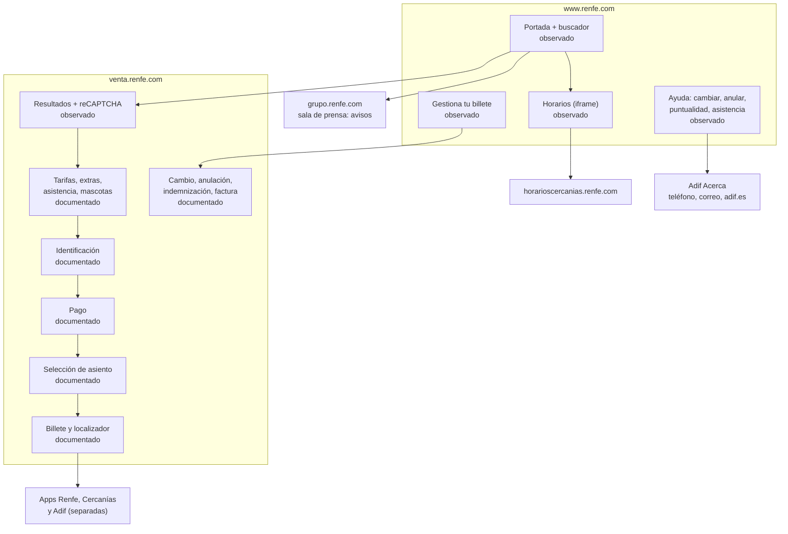
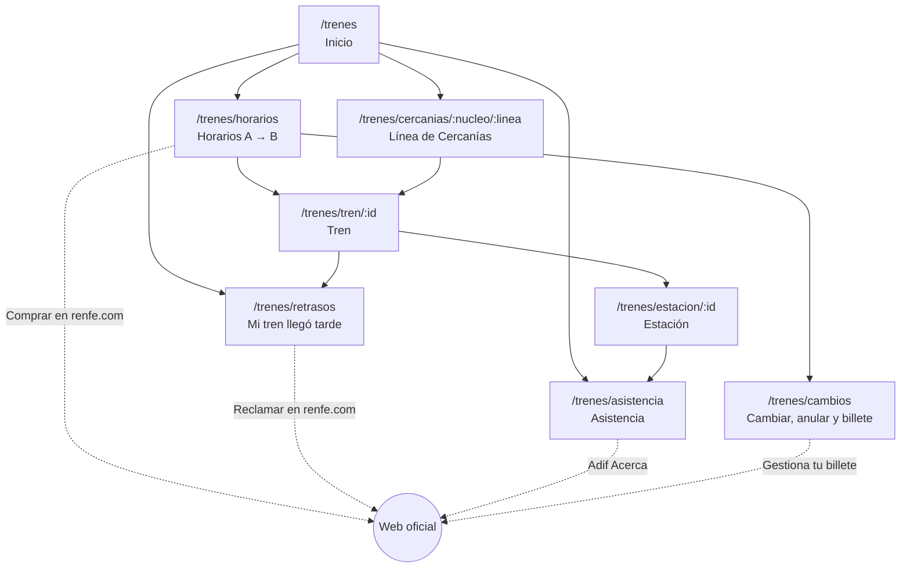

# Trenes: mapa de pantallas

Tres mapas: cómo está hoy renfe.com, las pantallas de la fase 1 del [brief](README.md) y un concepto de compra y billete. Todo se diseña primero a 390 px. Los bocetos usan datos ficticios, salvo el aviso de la línea C4, copiado del feed del 19/10/2026.

## Mapa actual de Renfe

Lo marcado como **observado** se recorrió el 19/10/2026. Lo **documentado** sale de las [condiciones de venta](https://www.renfe.com/es/es/ayuda/informacion-legal-viajeros/billetes-abonos/condiciones-legales-venta-billetes) y de las FAQ, porque no se pasó del CAPTCHA.



Lo que el mapa deja ver:

- **Dominios.** La compra pasa por al menos cuatro dominios: `www.renfe.com`, `venta.renfe.com`, `horarioscercanias.renfe.com` y `grupo.renfe.com`. Además están `adif.es` y tres apps.
- **Asiento después de pagar.** Según la documentación, la persona paga sin saber qué asiento tendrá, mientras que la ficha del Básico lo vende como extra de 5 €.
- **Incidencias dispersas.** Están en la sala de prensa, en WhatsApp para 2 líneas y en las apps, y no hay una vista por tren.

## Fase 1: información pública



| Pantalla                                                  | Pregunta                                 | Datos y fuente                                                                                                                                                                                                               | Acción principal                                                                     |
| --------------------------------------------------------- | ---------------------------------------- | ---------------------------------------------------------------------------------------------------------------------------------------------------------------------------------------------------------------------------- | ------------------------------------------------------------------------------------ |
| **Inicio** `/trenes`                                      | ¿Qué necesito?                           | Ninguno, solo navegación                                                                                                                                                                                                     | Buscar origen y destino                                                              |
| **Horarios** `/trenes/horarios?de=&a=&fecha=`             | ¿Qué trenes hay y cómo van?              | GTFS AV/LD/MD y Cercanías (horario, tipo, duración, `wheelchair_accessible`) y GTFS-RT (retraso)                                                                                                                             | Abrir un tren. Enlace secundario: «Comprar en renfe.com»                             |
| **Tren** `/trenes/tren/:id`                               | ¿Dónde está y a qué hora llega?          | `stop_times`, `trip_updates` (retraso por parada), `vehicle_positions` y avisos que afectan a su línea                                                                                                                       | Ver paradas. Si el retraso supera un umbral de indemnización, «¿Qué me corresponde?» |
| **Línea de Cercanías** `/trenes/cercanias/:nucleo/:linea` | ¿Hay incidencias en mi línea?            | `alerts` filtrados por `routeId`, con próximos trenes y su retraso                                                                                                                                                           | Ver próximos trenes                                                                  |
| **Estación** `/trenes/estacion/:id`                       | ¿Es accesible y cómo pido ayuda?         | GTFS `stops` (`wheelchair_boarding`) y la modalidad de Adif Acerca (permanente o puntual) según la [lista de Adif](https://www.adif.es/viajeros/accesibilidad-estaciones), pendiente de una fuente verificable               | Pedir asistencia                                                                     |
| **Mi tren llegó tarde** `/trenes/retrasos`                | ¿Qué me corresponde y dónde lo pido?     | Tres capas de normas (ver [brief](README.md#indemnizaciones-tres-capas-que-no-coinciden)) y plazos                                                                                                                           | «Reclamar en renfe.com»                                                              |
| **Cambiar, anular y billete** `/trenes/cambios`           | ¿Qué permite mi billete y cómo lo llevo? | [Cambiar](https://www.renfe.com/es/es/ayuda/cambiar-billete), [anular](https://www.renfe.com/es/es/ayuda/anular-billete) y [FAQ de compra](https://www.renfe.com/es/es/ayuda/faqs/compra-billetes) por tarifa y tipo de tren | «Gestiona tu billete» en renfe.com                                                   |
| **Asistencia** `/trenes/asistencia`                       | ¿Cómo y cuándo la pido?                  | [Servicio de asistencia](https://www.renfe.com/es/es/viajar/informacion-util/servicio-de-asistencia/que-es): canales y plazos (30 min o 12 h según la estación)                                                              | Llamar o escribir a Adif Acerca                                                      |

Ninguna pantalla pide localizador, importe ni datos personales. **Mi tren llegó tarde** solo hace tres preguntas: tipo de tren, fecha de compra y minutos de retraso. Las respuestas no se guardan y no salen del navegador.

### Bocetos a 390 px

```
Inicio                                Horarios
─────────────────────────────         Madrid → Zaragoza · jue 22/10
¿A dónde vas?                         ─────────────────────────────
Desde [Madrid-Puerta de Atocha ]      07:30 → 08:51  1 h 21 min
Hasta [Zaragoza-Delicias       ]        AVE · accesible
Fecha [hoy ▾]                           Puntual · dato de hace 20 s
[ Ver trenes ]                        ─────────────────────────────
─────────────────────────────         08:00 → 09:21  1 h 21 min
Hoy                                     AVE · accesible
  ¿Va bien mi tren? →                   Retraso de 23 min
  Incidencias de Cercanías →          ─────────────────────────────
Algo ha ido mal                       09:05 → 10:56  1 h 51 min
  Mi tren llegó tarde →                 Alvia · sin datos de
  Cambiar o anular →                    accesibilidad
Accesibilidad                         ─────────────────────────────
  Pedir asistencia →                  Precios y compra solo en
─────────────────────────────           renfe.com ↗
Proyecto independiente,               Datos: Renfe Data · CC BY 4.0
sin vinculación con Renfe ni Adif
```

```
Tren · AVE 03063                      Mi tren llegó tarde
Madrid-Puerta de Atocha → Barcelona   ─────────────────────────────
─────────────────────────────         Tipo de tren   [AVE/LD    ▾]
● Retraso de 23 min                   Comprado el    [12/02/2026  ]
  Dato oficial de hace 40 s           Retraso        [75] min
─────────────────────────────         ─────────────────────────────
08:00  Madrid-Puerta de Atocha  ✓     Renfe: 50 %
09:21  Zaragoza-Delicias  09:44 ●       Compromiso de puntualidad ↗
11:30  Barcelona-Sants   ~11:53       UE: 25 % (mínimo)
─────────────────────────────           Reglamento 2021/782, art. 19 ↗
Aviso de la línea                     ⚠ Si la causa es una limitación
  Sin avisos abiertos                   de velocidad de Adif, Renfe no
─────────────────────────────           indemniza; la UE no lo exime.
[ ¿Qué me corresponde? ]                Ley 9/2025, DA 31.ª ↗
                                      ─────────────────────────────
Datos: Renfe Data · CC BY 4.0         Plazo: de 24 h a 3 meses tras
                                      el viaje
                                      [ Reclamar en renfe.com ↗ ]
```

```
Línea C4 · Cercanías Madrid           Estación · Zaragoza-Delicias
─────────────────────────────         ─────────────────────────────
⚠ Avisos sin actualizar desde         Accesible en silla de ruedas
  las 09:32 del 07/10. Pueden           (dato de Renfe Data)
  no reflejar la situación actual.    Asistencia Adif Acerca:
─────────────────────────────           servicio permanente
Por reajuste de servicio, el tren       Pídela hasta 30 min antes
de las 09:05 inicia su recorrido      ─────────────────────────────
en Tres Cantos…                       [ Llamar a Adif Acerca ]
  Desde el 07/10 · Renfe no indica      917 744 040 · 06:00–00:00
  cuándo termina                      Escribir a Adif Acerca ↗
─────────────────────────────         ─────────────────────────────
Próximos trenes                       Trenes que salen ahora →
  09:41 Parla · puntual               Fuente: Renfe, servicio de
  09:47 Parla · 4 min tarde             asistencia ↗ (19/10/2026)
```

### Estados comunes

| Estado                                                        | Qué muestra                                                                                          |
| ------------------------------------------------------------- | ---------------------------------------------------------------------------------------------------- |
| Identidad                                                     | «Proyecto independiente, sin vinculación con Renfe ni Adif», sin logotipo ni colores de Renfe        |
| Dato desactualizado, sin tiempo real o aviso sin fecha de fin | Ver [cuando algo falla](arquitectura.md#arquitectura-técnica). Nunca se presentan como estado actual |
| Fuentes en conflicto                                          | Cada fuente con su enlace. No elegimos una por la persona                                            |
| Sin datos                                                     | Qué falta y el enlace a la página oficial equivalente                                                |
| Enlace externo                                                | Dominio visible y solo hacia dominios oficiales: `renfe.com`, `adif.es`, `boe.es`, `data.renfe.com`  |

## Concepto: compra y billete

Es un diseño de referencia y **no se construye**. Sirve para dos cosas: proponer a Renfe cómo podría ser la compra y evaluar su sistema nuevo a partir del 25/01/2027 con la lista de [criterios.md](criterios.md#concepto-de-compra-y-billete). El pago, la identificación, el CAPTCHA y la emisión del billete son siempre de Renfe.

```mermaid
graph LR
  buscar["1 · Buscar<br/>solo ida por defecto"] --> comparar["2 · Comparar trenes<br/>precio total, duración,<br/>accesibilidad"]
  comparar --> tarifa["3 · Elegir tarifa<br/>cambio y anulación en €"]
  tarifa --> extras["4 · Asiento, mascota,<br/>bicicleta y asistencia"]
  extras --> viajeros["5 · Viajeros<br/>documento si es nominativo"]
  viajeros --> revisar["6 · Revisar<br/>todo y total final"]
  revisar --> pago["7 · Pago<br/>oficial"]
  pago --> billete["8 · Billete<br/>QR, Wallet, PDF"]
  billete --> posventa["Cambiar, anular,<br/>indemnización y factura<br/>desde el billete"]
```



| Paso         | Qué cambia frente a lo observado o documentado hoy                                                                                                                                                                                  |
| ------------ | ----------------------------------------------------------------------------------------------------------------------------------------------------------------------------------------------------------------------------------- |
| 1 · Buscar   | Solo ida por defecto, con la vuelta como opción. Hoy viene preseleccionada ida y vuelta (hoy y mañana)                                                                                                                              |
| 2 · Comparar | Precio total por trayecto desde el primer momento, duración, transbordos, accesibilidad y, si Renfe la publica, ocupación. Los avisos van junto al tren afectado, no en un bloque que ocupa toda la primera pantalla                |
| 3 · Tarifa   | Una tabla con lo que cuesta cambiar y anular en euros para ese billete, no por nombre de tarifa. Las contradicciones de hoy (Básico «no admite anulaciones» frente a «anulación sin gastos en 2 h») se resuelven antes de mostrarla |
| 4 · Extras   | El asiento se elige **antes** de pagar. La asistencia PMR aparece al mismo nivel que el asiento, no escondida                                                                                                                       |
| 5 · Viajeros | Se dice por qué se pide cada dato (billete nominativo con identificación). Se puede comprar sin cuenta                                                                                                                              |
| 6 · Revisar  | Todo en una pantalla: tren, asiento, extras, condiciones de cambio y anulación y total final. Nada aparece por primera vez después de pagar                                                                                         |
| 7 · Pago     | El pago oficial de Renfe con su CAPTCHA. Un error conserva lo introducido y dice qué hacer                                                                                                                                          |
| 8 · Billete  | QR en pantalla, Wallet y PDF accesible. Indica si el billete incluye el Combinado Cercanías y cómo recuperarlo sin cuenta, sin tener que ir a una máquina con la tarjeta de pago                                                    |

```
Comparar · Madrid → Zaragoza          Revisar antes de pagar
jue 22/10 · 1 adulto · solo ida       ─────────────────────────────
─────────────────────────────         AVE 08:00 → 09:21 · jue 22/10
08:00 → 09:21 · AVE · directo         Coche 4 · asiento 7A (ventana)
1 h 21 min · accesible                Mascota (≤ 10 kg)        10 €
Desde 23,10 € en total                Asistencia Adif Acerca
  Cambio 10 € · sin reembolso           en origen y destino     0 €
  ⚠ Obras: puede llegar más tarde     ─────────────────────────────
─────────────────────────────         Si cambias de plan
09:05 → 10:56 · Alvia · directo         Cambiar: 1.º gratis
1 h 51 min · accesible                  Anular: te devuelven 70 %
Desde 19,40 € en total                ─────────────────────────────
  Cambio 10 € · sin reembolso         Total                  54,25 €
─────────────────────────────         Pagarás en la web de Renfe.
[ Elegir 08:00 ]                      [ Ir al pago ]
```
